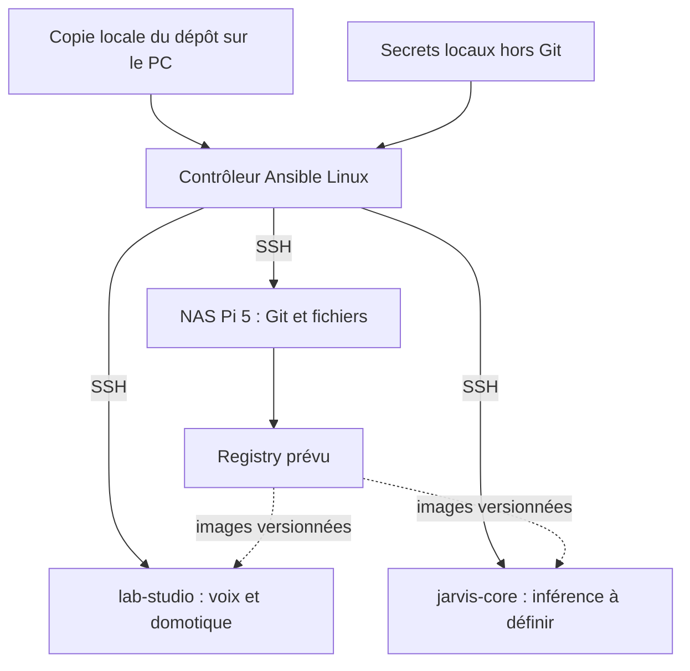

# Architecture — exploitation du homelab

> Rôle : responsabilités et modèle de gestion commun à toutes les machines.
> Mise à jour : 6 novembre 2026.
> Statut : décision Linux + Ansible + Compose validée ; migration en cours.

## Principe

Un dépôt décrit la configuration ; un contrôleur Linux applique les changements
par SSH ; chaque machine continue de fonctionner quand ce contrôleur est éteint.
Le NAS n'est pas requis pour reconstruire son propre socle : configuration,
secrets de restauration et sauvegardes doivent être accessibles hors du NAS.

## Une définition par responsabilité

| Couche | Source et responsabilité |
|---|---|
| OS initial | Image officielle ARM64 pour le Pi ; compte administrateur et SSH |
| Machine | Ansible : paquets, comptes techniques, dossiers et configuration système |
| Application conteneurisée | Compose : image, ports, volumes, réseau et santé |
| Application système | Unité systemd gérée par Ansible |
| Paramètres par machine | Inventaire Ansible local, puis versionnement des paramètres non sensibles après validation |
| Secrets | Fichiers locaux privés pour commencer ; sauvegarde séparée |
| Données | Stockage persistant et sauvegardes, distincts de la définition des services |

Ansible ne duplique pas les conteneurs dans ses tâches : il distribue et applique
les fichiers Compose. Une modification d'OS ou un accès GPU reste une opération
de la couche machine. Les images applicatives sont construites séparément, puis
distribuées par un registry ; le build local de l'exporteur n'est qu'une transition.

## Cycle d'exploitation

Inventorier, sauvegarder, consulter les différences, appliquer sur une machine,
vérifier le service, puis consigner l'état constaté. Les autres machines ne sont
intégrées qu'après ce premier retour d'expérience.

La restauration initiale, la préparation d'un disque et l'activation du miroir
GitHub sont des opérations distinctes du déploiement ordinaire. Un déploiement
ne doit pas effacer les données ni pousser un historique Git incomplet.

## État de la migration

Le nouvel OS du Pi 5 est installé selon l'utilisateur. L'adresse du nouveau NAS,
son stockage et l'accès SSH restent à confirmer. Le dépôt n'affirme donc pas que
les services ont été restaurés. Les documents de juillet décrivent l'ancien état
et restent des références de restauration jusqu'à validation du nouvel état.
