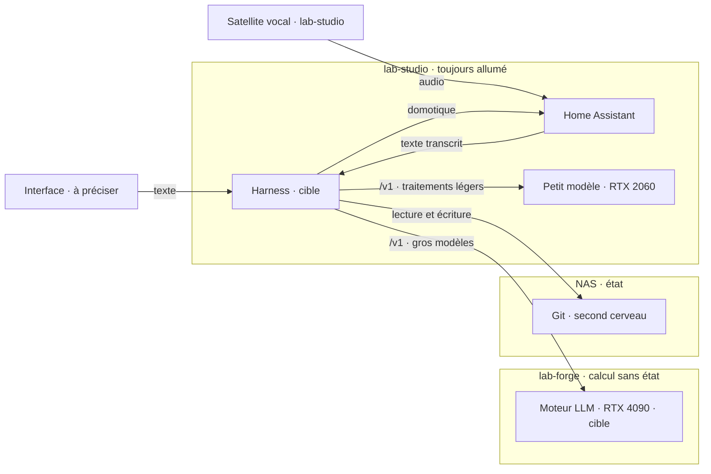
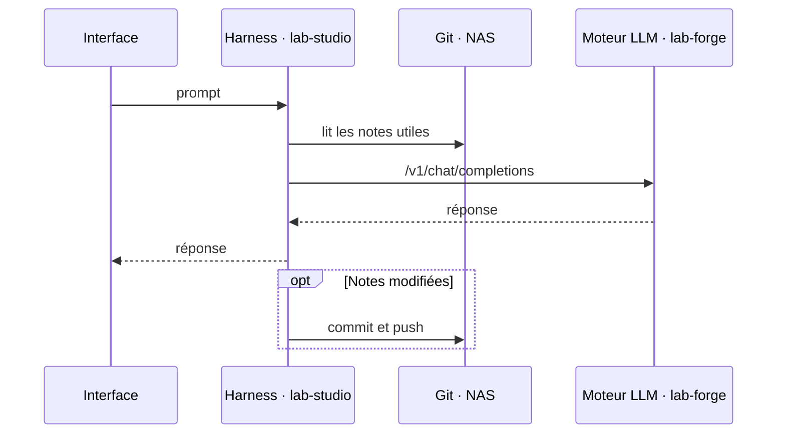
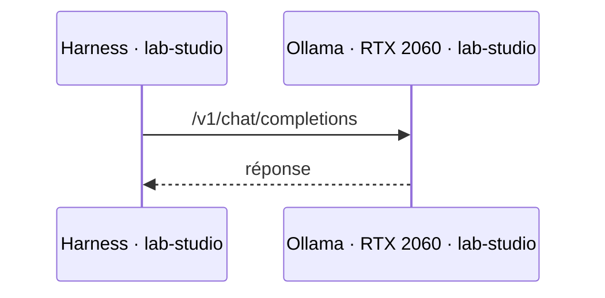
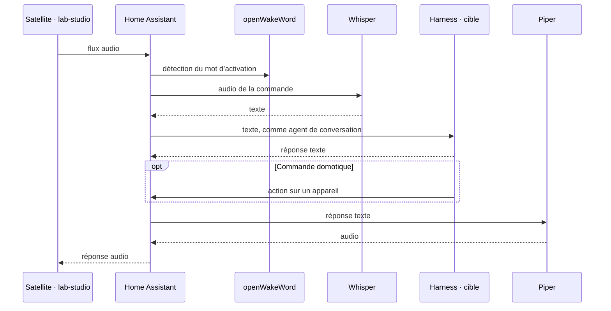

# Parcours des requêtes

Ce document décrit comment une requête traverse le homelab, de l’interface jusqu’au modèle. Les raisons de cette répartition sont dans la [décision 002](../decisions/002-repartition-des-roles.md). Les machines, les réseaux et les ports sont dans [Topologie logique](topologie-logique.md) et [Réseau](reseau.md).

L’architecture est en cours de montage. Chaque parcours indique son statut :

- **en place** : déployé par Ansible et observé ;
- **cible** : prévu, pas encore construit ;
- **à préciser** : choix pas encore fait.

## Vue d’ensemble

Les flèches indiquent qui initie l’échange. Tous les appels aux modèles utilisent l’API compatible OpenAI fournie directement par le moteur (`/v1/chat/completions`), sans passerelle.

## 1. Requête texte : travail et second cerveau

**Statut :** cible. Ni le harness ni le moteur de `lab-forge` ne sont déployés.
**Déclencheur :** un prompt envoyé depuis l’interface, qui reste à préciser.

**Données :** le second cerveau est lu et écrit dans son dépôt Git du NAS. Le mode d’accès du harness (clone Git sur `lab-studio` ou montage Samba) reste à préciser. Rien n’est conservé sur `lab-forge`.
**Si `lab-forge` est indisponible :** pas de gros modèle. Le harness renvoie une erreur, ou se rabat sur le petit modèle si la tâche le permet. Ce comportement reste à définir dans le harness.

## 2. Petit traitement

**Statut :** cible pour l’appel par le harness. Ollama tourne déjà sur la 2060 de `lab-studio`, avec le modèle déclaré dans les [variables de lab-studio](../../ansible/host_vars/lab-studio.yml).
**Déclencheur :** une tâche légère décidée par le harness, comme un classement, un résumé court ou une commande domotique.

**Données :** aucune donnée propre. Les modèles sont dans le volume Docker `ollama` de `lab-studio`.
**Limite :** 6 Gio de VRAM, soit des modèles d’environ 3 à 4 milliards de paramètres en quantification 4 bits.

## 3. Requête vocale

**Statut :** en partie en place. La chaîne Home Assistant, avec Whisper, Piper, openWakeWord et Ollama, est déployée sur `lab-studio`. Le satellite est à l’arrêt tant que le ReSpeaker est débranché, et la chaîne complète reste à retester. Le passage par le harness est une cible : aujourd’hui, l’agent de conversation configuré dans Home Assistant reste à relever, car il n’est pas géré par Ansible.
**Déclencheur :** le mot d’activation prononcé près du ReSpeaker.

Le harness traite ensuite la requête comme au parcours 1 ou 2, selon le modèle nécessaire.
**Données :** la configuration de Home Assistant est dans son volume sur `lab-studio`. La conservation éventuelle de l’audio ou des transcriptions reste à vérifier.
**Si `lab-forge` est indisponible :** la voix reste utilisable avec le petit modèle de la 2060, puisque toute la chaîne est sur `lab-studio`.

## 4. Période d’essai sur `lab-forge`

**Statut :** cible.
**Déclencheur :** l’essai d’un autre modèle ou d’un autre moteur, décidé à la main.

Pendant un essai, l’inférence lourde habituelle n’est pas disponible. C’est un compromis accepté dans la [décision 002](../decisions/002-repartition-des-roles.md#compromis-acceptés-pour-linstant).

| Parcours | Pendant l’essai |
|---|---|
| 1. Requête texte | Indisponible avec le modèle habituel. Les réponses viennent du modèle en essai, ou le harness se rabat sur la 2060 |
| 2. Petit traitement | Inchangé |
| 3. Requête vocale | Inchangée si elle utilise le petit modèle |

**Changer de modèle ou de moteur :** le harness appelle toujours l’API `/v1`. Seuls l’adresse ou le nom du modèle changent. Un autre moteur compatible OpenAI, comme vLLM ou llama.cpp, peut remplacer Ollama le temps de l’essai.
**Revenir à la production :** redéployer le moteur et le modèle déclarés dans Ansible. La procédure reste à écrire, avec le profil de `lab-forge`.

## À préciser

- L’interface utilisée pour les requêtes texte.
- Le harness : techno, dépôt et emplacement sur `lab-studio`.
- L’accès du harness au second cerveau : clone Git ou montage Samba.
- L’agent de conversation actuellement configuré dans Home Assistant.
- Le comportement du harness quand `lab-forge` ne répond pas.
