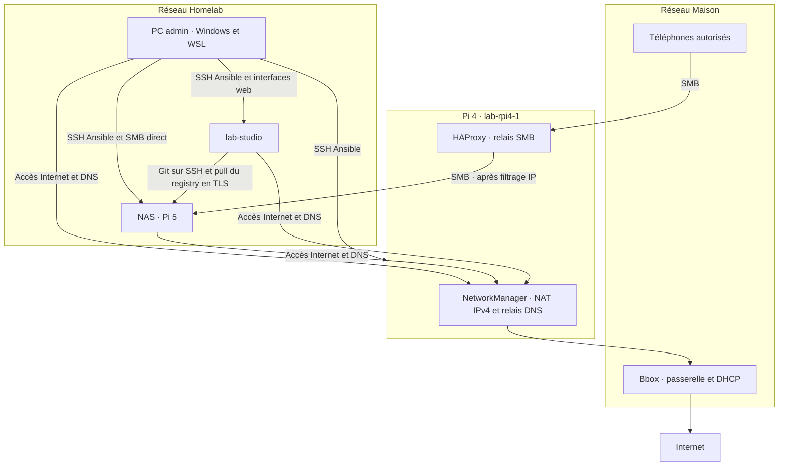
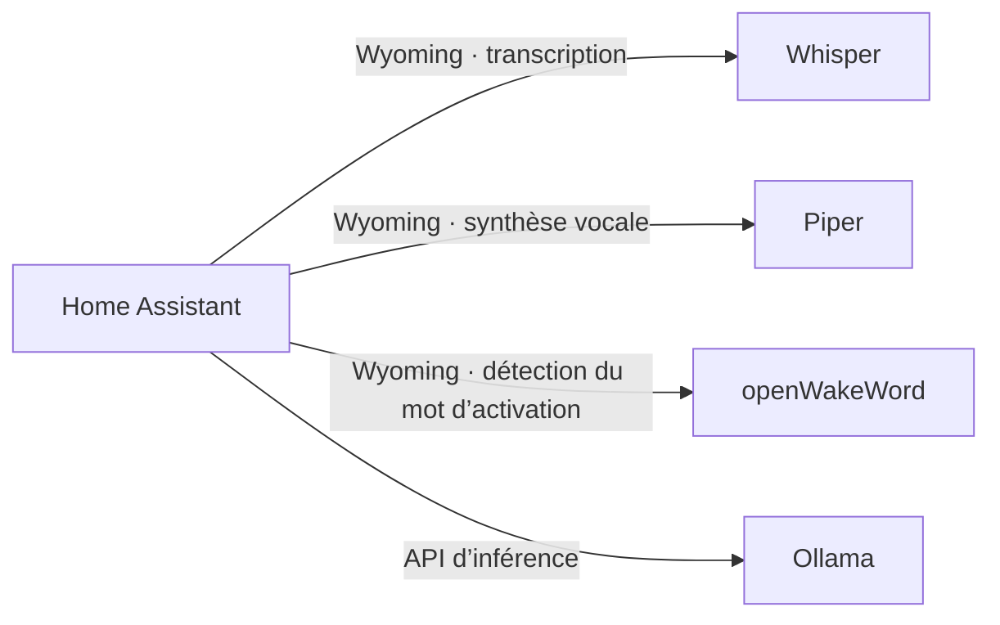

# Topologie logique

## Réseaux et accès

Le Pi 4 fournit aussi le DHCP du Homelab. Pour le SMB relayé, HAProxy vérifie l’adresse source et Samba vérifie ensuite le compte et les droits du partage. Le registry du NAS dispose d’un point d’accès de publication et d’un point d’accès de lecture. Tous deux utilisent le même stockage d’images.

## Services sur lab-studio

Les flèches indiquent quel composant initie chaque échange. Le schéma vocal décrit la chaîne de services. Le satellite est à l’arrêt, et la chaîne complète reste à retester après son rebranchement.

Les sous-réseaux, les adresses IP et les ports sont détaillés dans [Réseau](reseau.md).
