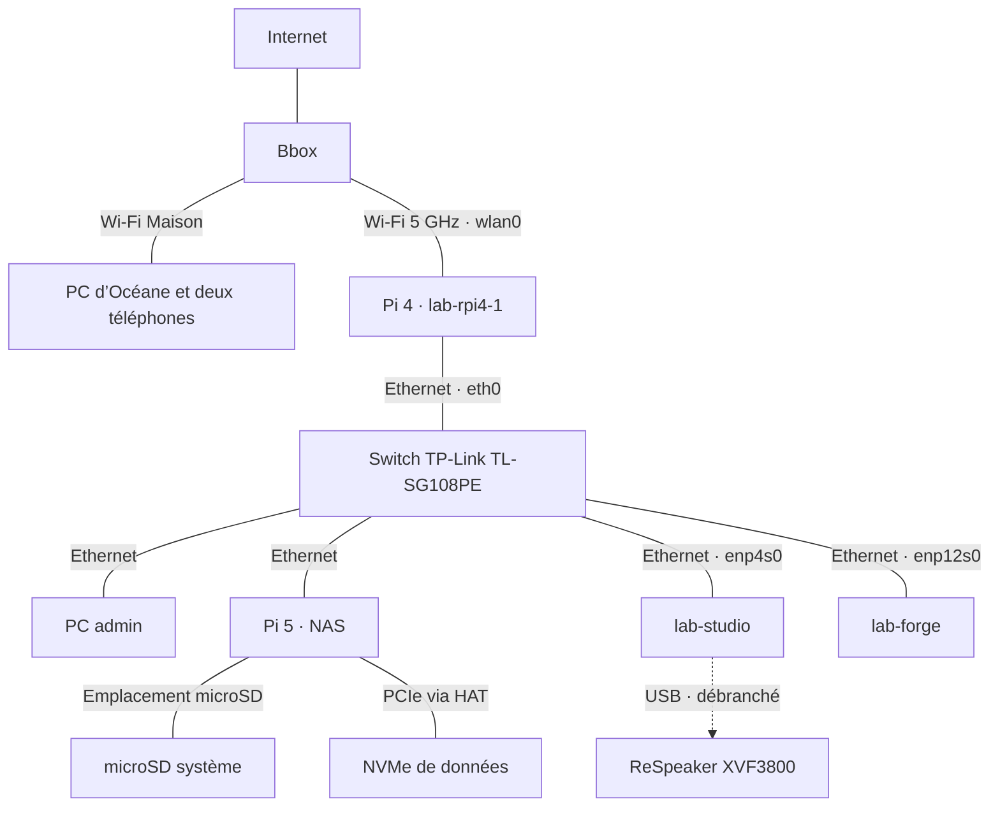

# Topologie physique

Le Pi 4 relie la Bbox en Wi-Fi au switch en Ethernet. `lab-forge` est branché sur le switch. Son Wi-Fi est inactif.

Pour les composants et leurs références, voir [Machines](machines.md). Les adresses des interfaces se trouvent dans [Réseau](reseau.md#adressage).
